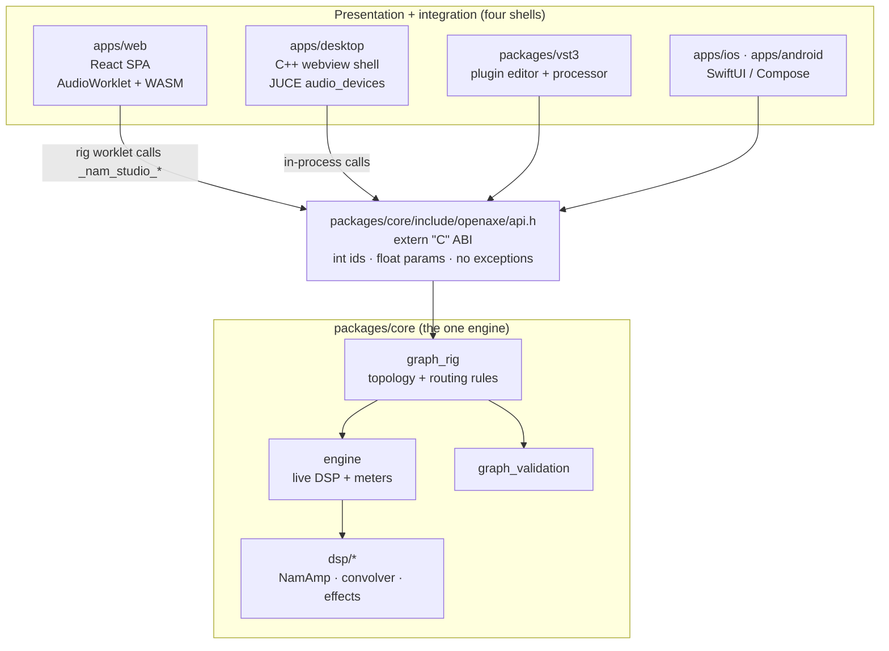
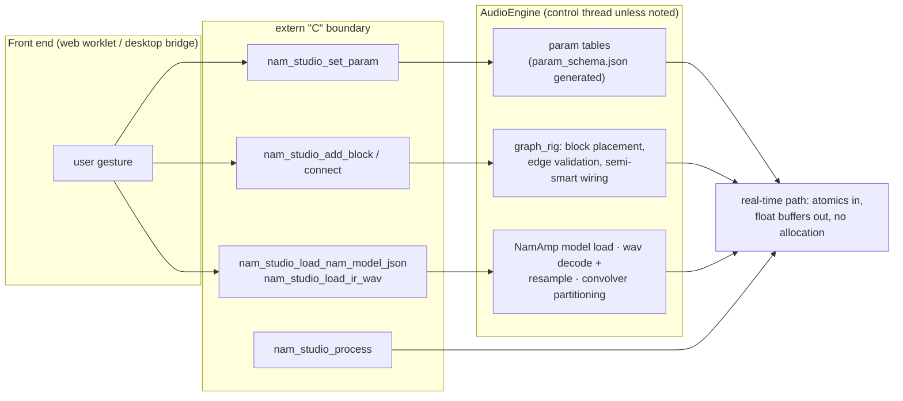
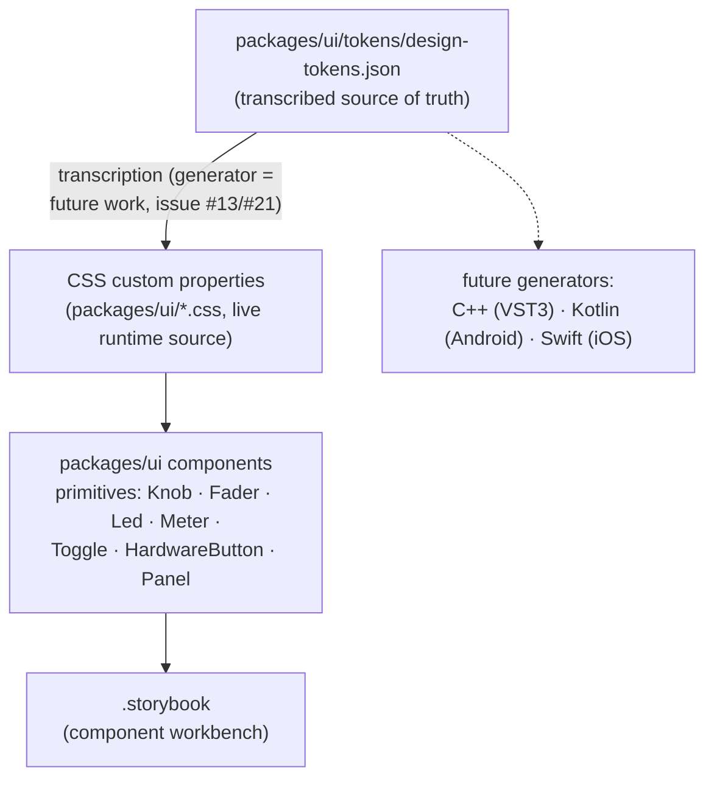

# Architecture: one C++ engine, four front ends

OpenAxe ships (or plans to ship) as a web app, a native desktop app, a
VST3/CLAP/AU plugin, and mobile apps. They are four shells around **one**
audio engine: `packages/core`, C++20, no platform APIs, no UI.

The rule this codebase is converging on:

> **All application logic lives in `packages/core`. A front end owns
> presentation, device/host integration, and persistence plumbing — nothing
> that decides how the rig sounds or behaves.**

"Logic" here means anything a second front end would otherwise have to
reimplement: DSP, signal routing and its rules, param semantics and ranges,
model/IR loading, metering, and the mapping between what a user sees and what
the DSP does.

## Layers

```
┌──────────────────────────────────────────────────────────────────────────┐
│ Presentation      apps/web (React) · desktop webview · VST3 editor ·     │
│                   iOS/Android views — all sharing packages/ui tokens     │
├──────────────────────────────────────────────────────────────────────────┤
│ Integration       Web Audio worklet · JUCE audio_devices + window.openAxe bridge  │
│                   · iPlug2 processor · JNI / AVAudioEngine               │
├──────────────────────────────────────────────────────────────────────────┤
│ Engine ABI        packages/core/include/openaxe/api.h — extern "C",   │
│                   int ids, float params, no exceptions, no allocation on │
│                   the real-time path                                     │
├──────────────────────────────────────────────────────────────────────────┤
│ Core              graph_rig · graph_validation · engine · dsp/*          │
└──────────────────────────────────────────────────────────────────────────┘
```

Every front end talks to the same `extern "C"` surface. It is deliberately
narrow (int block ids, float params, out-params instead of exceptions) so it
survives WASM, FFI, JNI, and a plugin host equally well.

### What the ABI already covers

Topology (`add_block`/`connect`/`move_block`, with validation), params by index
plus metadata (`block_param_info`), NAM model load/unload, reverb algorithm
choice **and** the user-facing reverb control mapping (`set_reverb_control`),
delay models, per-block bypass and I/O trims, master level/mute, per-block
meters, and CPU load.

### What a front end is still allowed to own

- Device and host integration: Web Audio graph plumbing, JUCE audio_devices streams, the
  plugin's process callback.
- Persistence _mechanism_: IndexedDB in the browser, files on desktop, host
  state chunks in a plugin. The preset _model_ belongs in core (see below).
- Rendering, layout, interaction, theming — `packages/ui` and the design
  tokens.
- Network services with no audio meaning (the Tone3000 model library client).

## Per-target status

| Concern                      | Web                                                 | Desktop                            | VST3 | Owner it should have                 |
| ---------------------------- | --------------------------------------------------- | ---------------------------------- | ---- | ------------------------------------ |
| DSP effects                  | core via the rig worklet                            | core, in-process                   | —    | core ✅                              |
| Amp (NAM inference)          | core's `NamAmp` via the rig worklet                 | core's `NamAmp`                    | —    | core ✅                              |
| Amp tone stack               | core (`tone_stack.cpp`) via the rig worklet         | core                               | —    | core ✅                              |
| Signal graph + routing rules | core `graph_rig` (single rig worklet)               | core `graph_rig`                   | —    | core ✅                              |
| Reverb control mapping       | core (`set_reverb_control`)                         | core                               | —    | core ✅                              |
| Block I/O trims              | core trims via the rig worklet                      | core trims                         | —    | core ✅                              |
| Bypass / master bus          | core via the rig worklet                            | core                               | —    | core ✅                              |
| Cab / IR convolution         | core (`convolver.cpp`) via the rig worklet          | core, IR decoded by `wav.cpp`      | —    | core ✅                              |
| Tuner pitch detection        | TS autocorrelation, main thread                     | same TS code                       | —    | **core** ❌                          |
| Metering                     | core peak (`get_meter`) via the rig worklet         | core peak + a synthesized waveform | —    | core ✅                              |
| Param ranges                 | hand-written in `paramSchema.ts`, guarded by a test | core table                         | —    | **generated from core** ⚠️           |
| Presets / scenes             | TS model + IndexedDB                                | same TS code in the webview        | —    | **core model**, front-end storage ❌ |
| MIDI mapping                 | TS Web MIDI                                         | —                                  | —    | **core** ❌                          |

✅ done · ⚠️ core owns it, a front end still duplicates part · ❌ not in core yet

## Migration order

Each step is useful on its own and unblocks the plugin target.

1. ~~**Amp on one engine.**~~ Done: the web path runs core's `NamAmp`, and the
   `neural-amp-modeler-wasm` npm package is gone - web and desktop no longer run
   different inference code. It also needed `nam_studio_load_nam_model_json` (a
   browser has no filesystem to hand a path to), which the desktop bridge now
   uses too rather than staging a temp file.
2. ~~**One graph.**~~ Done: the web path drives core's `graph_rig` from a single
   rig worklet (`wasm-core/namStudioRigWorklet.js`) that owns one `nam_studio_core`
   module and one `nam_studio_graph` for the whole rig, replacing the per-effect
   worklets and the TS Web Audio node graph. The trims, bypass, master bus,
   mixer per-input level/pan, splitter per-output level, routing validation and
   metering all collapsed into the engine in one move - `GraphRig.ts` is now a
   thin driver (mirroring `NativeGraphRig`), `graphValidation.ts` is a UI
   pre-check kept in lock-step with `graph_validation.cpp` by mirrored tests, and
   the per-effect worklets are deleted. This is the step the plugin needs, since
   a VST3 has no Web Audio to fall back on.
3. ~~**Convolution in core.**~~ Done: `dsp/convolver.cpp` is a zero-latency
   partitioned convolver, and `dsp/wav.cpp` decodes and resamples IR files
   for the platforms with no `AudioContext.decodeAudioData` - so the desktop app
   loads IRs by handing the core the file's bytes
   (`nam_studio_load_ir_wav`), exactly as it loads NAM models. The audio path now
   has no web-only DSP left.
4. **Tuner in core.** Pitch detection as a pure function over a buffer, called
   from the UI thread (web) or the control thread (desktop/plugin). It is not
   in the audio path, so it costs no latency either way.
5. **Preset/scene model in core**, with front ends supplying only storage. This
   is what lets a plugin save state into a host session and a desktop app write
   a file, from one definition.
6. **Generate the UI's param ranges** from `packages/core/param_schema.json`
   instead of hand-maintaining them in `paramSchema.ts`
   (`paramSchema.coreDrift.test.ts` guards the gap until then).
7. **MIDI mapping in core**, so a plugin and the mobile apps inherit it.

## Latency

The engine's own contribution is zero: `latency_test` pushes an impulse through
a rig and confirms the DSP path adds no delay — no lookahead, no latency
compensation to report to a host. Everything a user feels comes from the I/O
layer.

| Target  | What sets latency                                                                           | Lowest available                                                                                                                                                                                                                              |
| ------- | ------------------------------------------------------------------------------------------- | --------------------------------------------------------------------------------------------------------------------------------------------------------------------------------------------------------------------------------------------- |
| Desktop | JUCE audio_devices block size + the device's own buffering                                  | `bufferFrames: 0` asks the device for its smallest block; default is 128 frames ≈ 2.7ms one-way at 48kHz. `getConfig()` reports the backend's measured round-trip.                                                                            |
| Web     | The 128-frame AudioWorklet render quantum, plus the context's `baseLatency`/`outputLatency` | Fixed by the platform. `latencyHint: 'interactive'` is what the app requests; chaining worklet nodes adds **no** extra latency (they all run inside one quantum), so the win from step 2 above is CPU and behaviour parity, not milliseconds. |
| VST3    | The host's block size                                                                       | Nothing to add: report zero latency and process in place.                                                                                                                                                                                     |

Rules that keep it that way:

- **Never allocate, lock, or do IO on the audio thread.** Params reach the
  audio thread as plain atomics; anything that allocates (model loading,
  algorithm switches, buffer resizes) happens on the control thread with audio
  suspended. Each core function's comment states which side it belongs on.
- **Don't resample if you can avoid it.** Desktop falls back to the device's
  preferred rate rather than forcing 48kHz through the OS resampler.
- **Ask for real-time scheduling.** The desktop stream sets
  `RTAUDIO_SCHEDULE_REALTIME` with an explicit high priority for the backends
  that schedule their own callback thread.

## Adding to the core

- Put it in `packages/core`, with a test in `packages/core/tests`, before any
  front end learns about it.
- Extend `api.h` with the same shape as its neighbours (int ids, float values,
  no exceptions) and note its threading contract in the comment.
- If it's a user-facing control that doesn't map 1:1 onto a DSP param — like
  the reverb's room size — resolve that **in core** (`ReverbControl` is the
  pattern), not in each front end.
- Params come from `packages/core/param_schema.json`; run
  `node scripts/gen-param-schema.mjs` and commit the generated files (CI fails
  on drift).
- Two WASM build requirements that fail _silently_ if forgotten: the module is
  linked **whole-archive** (NAM's architecture parsers self-register via static
  initializers, and a plain link drops them - every model load then fails with a
  generic "bad model"), and it is compiled with **`-fexceptions`** (Emscripten
  disables exceptions by default, so the `throw` NAMCore uses to report a bad
  model aborts the whole AudioWorklet instead of being caught and turned into an
  error code).
- New ABI a browser needs must be added to `EXPORTED_FUNCTIONS` in
  `packages/core/CMakeLists.txt`, then `scripts/build-core-wasm.sh` re-run and
  the artifacts committed — nothing rebuilds them automatically.

## Diagrams

Rendered inline by GitHub (Mermaid). Same content as the sections above, in
picture form — added during the OpenAxe rebrand (issue #151).

### One engine, four shells



### Core engine: signal, params, and assets



### Design system: token pipeline


